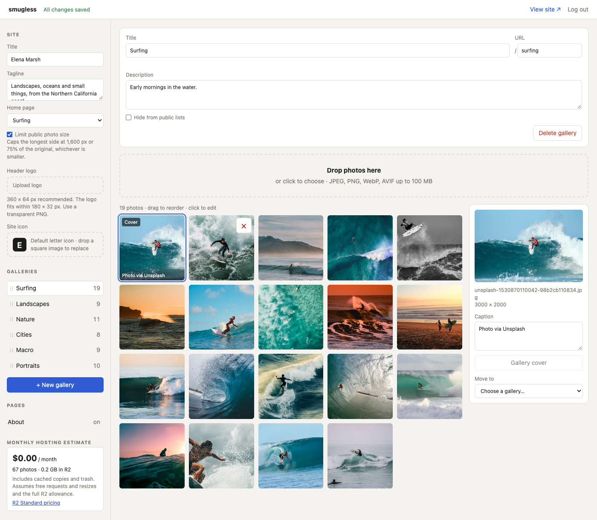

# smugless

An open-source, self-hosted photography portfolio with a built-in admin panel. Run it on your Cloudflare account for **$0 per month** within the free allowances.

[Try the live demo](https://smugless.kuril.in)

[](https://smugless.kuril.in)

Visitors get light, responsive galleries and a full-screen viewer with captions, swipe, and zoom. The demo uses Unsplash photos for a fictional portfolio.

## Admin panel

Sign in at `/login` with a password or a configured Google account. Changes save automatically.

- **Organize galleries.** Drag and drop to upload and reorder photos. Drop a photo on another gallery in the sidebar to move it. Add captions and choose covers.
- **Share by direct link.** Hide a gallery from the home page and navigation while keeping its URL available.
- **Customize the portfolio.** Choose a gallery or a grid for the home page. Set the site title and tagline, upload a header logo and favicon, and add an About page with a portrait, bio, and contact email.
- **Limit public photo size.** Originals stay in private storage. The app automatically caps each public copy at the smaller of 1,600 px and 75% of the original's longest side. You can turn the limit off.
- **Track storage.** See your photo count, storage use, and estimated monthly R2 storage cost.



Uploads support JPEG, PNG, WebP, and AVIF up to 100 MiB per file.

## Deploy your own

You need a Cloudflare account and Node.js.

```bash
git clone https://github.com/akurilin/smugless.git && cd smugless
npm install
npx wrangler login
npx wrangler r2 bucket create smugless-photos
npm run deploy
openssl rand -base64 18 | tr -d '\n' | tee .admin-password | npx wrangler secret put ADMIN_PASSWORD
```

Open `/login` at the URL Wrangler prints. Sign in with the password in `.admin-password`. The admin needs a password of at least 12 characters. The `openssl` command above makes 24.

Password checks are limited to 10 a minute per IP address, through the `LOGIN_LIMITER` rate-limit binding in `wrangler.jsonc`. Without that binding there is no limit.

Scripts can also authenticate with HTTP Basic auth on `/api/*`. If yours sign in with the form instead, as `scripts/seed.mjs` does, set the `ADMIN_BASIC_AUTH` var to `off`. Then the password is only sent at sign-in.

<details>
<summary>Sample photos and custom domains</summary>

Load sample galleries with Unsplash photos.

```bash
SMUGLESS_URL=https://smugless.<your-subdomain>.workers.dev SMUGLESS_PASSWORD="$(cat .admin-password)" node scripts/seed.mjs
```

For site-specific settings, copy `wrangler.jsonc` to `wrangler.local.jsonc`, which Git ignores. Use `env.demo` as an example and add an environment with your Worker name and R2 bucket. Run `npm run deploy -- --config wrangler.local.jsonc --env <site>`.

For a domain on Cloudflare DNS, add a `routes` entry with `custom_domain: true` to your Worker config. For DNS hosted elsewhere, see the demo setup below.

</details>

<details>
<summary>Google sign-in for admins</summary>

Set `ADMIN_AUTH` to `google` to use a Gmail or Google Workspace account. The default is `password`.

1. In Google Cloud, create a Web application OAuth client. Add `https://your-site.example/auth/google/callback` as an authorized redirect URI for each hostname. Leave authorized JavaScript origins blank. [Google OAuth setup](https://developers.google.com/identity/openid-connect/openid-connect)
2. Store the client secret as the `GOOGLE_CLIENT_SECRET` Worker secret. For a named local environment, run `npx wrangler secret put GOOGLE_CLIENT_SECRET --config wrangler.local.jsonc --env <site>`.
3. Add these `vars` to your site's environment in `wrangler.local.jsonc`, then deploy it.

   ```json
   "vars": {
     "ADMIN_AUTH": "google",
     "GOOGLE_CLIENT_ID": "your-client-id.apps.googleusercontent.com",
     "GOOGLE_ADMIN_EMAIL": "admin@example.com"
   }
   ```

Open `/login` to start Google sign-in.

</details>

## Storage and cost

One Cloudflare Worker serves the site. Cloudflare Images creates responsive AVIF and WebP copies on demand. A private R2 bucket stores the site settings, originals, and resized copies. When you delete a photo, its original moves to trash and still uses storage. Keep a separate backup of your originals.

The admin estimate covers storage. For current rates and allowances, see [Workers pricing](https://developers.cloudflare.com/workers/platform/pricing/), [R2 pricing](https://developers.cloudflare.com/r2/pricing/), and [Images pricing](https://developers.cloudflare.com/images/pricing/).

<details>
<summary>Maintenance and demo deployment</summary>

### Maintenance commands

```bash
npm run deploy                              # deploy
npx wrangler secret put ADMIN_PASSWORD      # change the admin password
npm run tail                                # live logs
npm run typecheck
npm test                                    # unit tests (vitest)
```

### Demo deployment

The demo uses `env.demo` in `wrangler.jsonc`, with a separate Worker, bucket, and password. The Pages project in `demo-proxy/` forwards its custom domain to the demo Worker through a service binding.

GitHub Actions deploys the demo Worker on pushes to `main`. The `demo` environment uses the `CLOUDFLARE_ACCOUNT_ID` variable and the `CLOUDFLARE_DEMO_API_TOKEN` secret. Give the token Editor access to the `smugless-demo` Worker.

Use these commands for manual maintenance.

```bash
npm run deploy:demo
npx wrangler secret put ADMIN_PASSWORD --env demo
npm run deploy:demo-proxy
```

For an external DNS host, the demo uses a CNAME from its custom subdomain to the Pages hostname.

</details>

## License

MIT. Bundled libraries: [PhotoSwipe](https://photoswipe.com) and [SortableJS](https://github.com/SortableJS/Sortable), both MIT (see `public/vendor/`).
